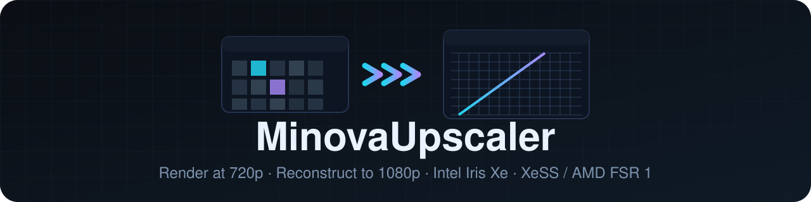
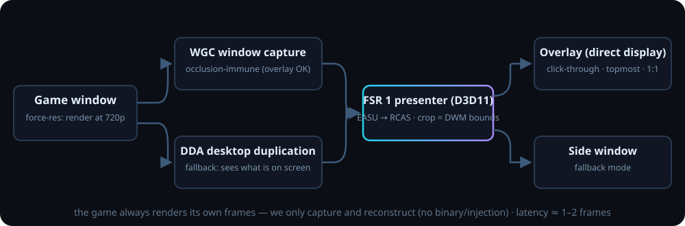

<div align="center">
  
</div>

# MinovaUpscaler

Universal Intel iGPU game upscaler for old laptops (Iris Xe class):
**render low → reconstruct high**, honestly. Two tools in one repo:

1. **`minova_poc`** — scripted 3D scene benchmark with XeSS-SR and AMD FSR 1
   behind the same quality presets and GPU-timing telemetry
   (true render-resolution upscaling: the scene really renders at the
   internal resolution with jitter/motion vectors/depth for XeSS).
2. **`minova_capture`** (+ GUI) — capture-based upscaler for real games:
   shrink the game window to 720p-class (`--force-res`, plain Win32 window
   management), capture its output (WGC / Desktop Duplication), and
   reconstruct to 1080p with FSR 1 in a click-through overlay or a side
   window. No injection, no game binary touched — see
   [docs/rules.md](docs/rules.md).

<p align="center">
  
</p>

## Quick start (Windows, VS 2022, x64)

```powershell
cmake -S . -B build
cmake --build build --config Release

# capture upscaler GUI: window picker + force-res + overlay + uncapped fps
.\build\Release\minova_capture.exe

# scripted PoC benchmark (XeSS path, 8 seconds, telemetry CSV)
.\build\Release\minova_poc.exe --mode xess --seconds 8
```

Run from the build directory — `libxess.dll`, `libxell.dll` and `shaders\`
are copied next to the exe by the build.

## Documentation

| file | contents |
|---|---|
| [docs/capture_pipeline.md](docs/capture_pipeline.md) | Phase 3 architecture: WGC/DDA sources, one-device D3D11 EASU→RCAS presenter, crop math (DWM bounds), `--force-res`, `--overlay`, `--novsync`, CLI reference, verification log |
| [docs/gui.md](docs/gui.md) | GUI usage, child-process isolation, **how to benchmark with uncapped FPS**, troubleshooting |
| [docs/machine_findings.md](docs/machine_findings.md) | OS/driver quirks hit while building (WGC AV on Insider 26200, PrintWindow hang, minimized-target geometry, D3D11 flip index quirk…) |
| [docs/rules.md](docs/rules.md) | hard rules: what we may/may not touch, why driver-level forcing is out of scope for V1, honesty requirements |
| [docs/phase1_report.md](docs/phase1_report.md) | XeSS-SR PoC — verified results and timings |
| [docs/phase2_report.md](docs/phase2_report.md) | FSR 1 in-app — verified results and timings |
| [info.md](info.md) | original mission brief and project constraints |
| [agent.md](agent.md) | continuation notes for the next agent |

## Status snapshot

* ✅ **Phase 1** — XeSS-SR PoC end-to-end: scene 960×540 → 1920×1080
  (balanced), telemetry CSV, auto-recovery from one-time JIT device-hung.
* ✅ **Phase 2** — FSR 1 in-app (EASU+RCAS): 4/4 × 20 s stable,
  ~6.5 ms upscale GPU @1080p; `T` cycles xess → bilinear → fsr → native.
* ✅ **Phase 3** — capture upscaler: WGC + DDA backends, D3D11 FSR presenter,
  window/`--pid` targeting, `--force-res 1280 720`, click-through overlay
  mode, uncapped present; soak 30 s @60 fps verified on the dev machine.
* ⏳ Needs a non-Insider OS build to demo **overlay** visually (WGC is
  currently broken machine-wide on 26200.9457; side-window mode works today).

## Honest play

Capture latency ≈1–2 frames. FSR 1 is spatial-only — quality below a
temporal upscaler on animation. The game always renders its own frames; we
never claim DLSS-class or "free 4K". Full rules:
[docs/rules.md](docs/rules.md).

## Third-party / licenses

* **Intel XeSS SDK 2.0.2** — vendored unmodified under `third_party/xess/`
  (Intel Simplified Software License: binary-only redistribution — keep
  `third_party/xess/LICENSE.txt` when shipping).
* **AMD FidelityFX-FSR 1** — vendored headers under
  `third_party/FidelityFX-FSR/` (MIT, © 2021 Advanced Micro Devices, Inc.);
  compiled into our shaders, never modified.
